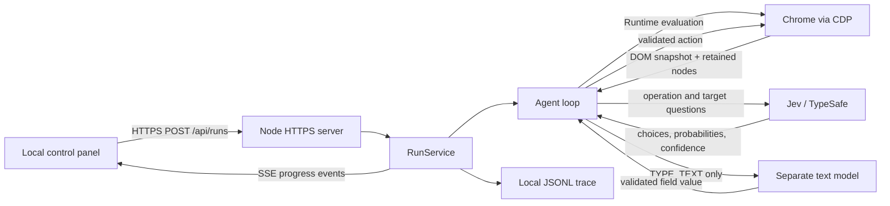

# Control and decision architecture

## Request path

The server and browser service are separate modules in one Node process. There is no extra HTTP hop to Chrome: the browser service owns a direct CDP WebSocket. One run executes at a time; additional starts receive HTTP 409. A service instance retains the last ten run histories in memory. Every run also writes `artifacts/runs/<id>.jsonl`. Restarting the server clears its in-memory run list; persisted files remain available on disk. Closing the panel tab does not stop a run; use Stop, or stop the server.

## Is CDP enough?

**CDP is sufficient as the browser protocol. A reliable automation layer above it is still necessary.** Browser Harness itself exposes a CDP connection plus browser lifecycle and reusable helpers. Jev Ultrafast's browser adapter uses that connection for CDP commands and implements its own snapshot and action checks. Browser Harness is therefore an implementation option, not a Jev requirement.

For this Node/TypeScript project, keep the direct CDP transport and evolve our `src/browser/` modules as that automation layer. This avoids a second Python service while keeping the decision model independent from the executor. This is an engineering choice, not a measured performance advantage over Browser Harness.

Already implemented:

- Isolated Chrome launch or an owned tab on an existing CDP endpoint.
- Persistent WebSocket, request correlation, timeouts, and disconnect errors.
- Visible DOM observations with retained references to the exact observed nodes.
- Allowed operation/target validation, page freshness checks, hit testing, and stale-decision retries.
- CDP mouse and keyboard input, field replacement, native dropdown selection, and viewport scrolling.
- Run budgets, no-progress stopping, cooperative cancellation, event logs, and optional outcome verification.

Still needed for broader reliability:

- Navigation/load lifecycle handling and bounded state-based settling instead of fixed delays.
- Frame and execution-context tracking, shadow DOM traversal, new tabs and popups.
- Better accessible-name computation, nested scrolling, custom widgets, dialogs, uploads, and downloads.
- Resilient browser reconnect and explicit recovery policy after ambiguous input failures.
- Tests on representative real tasks, independent success checks, latency/cost measurement.

Current freshness checks and input dispatch are separate calls: a page can change between them. Never retry an action merely because the transport errored after dispatch; it may already have executed. The current runner retries only explicit pre-action stale failures and stops on other errors.

Sources: [Browser Harness README](https://github.com/browser-use/browser-harness), [Jev Ultrafast browser adapter](https://github.com/browser-use/jev-ultrafast/blob/main/jev_ultrafast/browser.py), [Chrome DevTools Protocol](https://chromedevtools.github.io/devtools-protocol/).

## Decision space

`buildActionSpace(context)` in `src/providers/action-space.ts` builds a new space for each observation. The IDs are local to that snapshot. The model never invents a selector, coordinate, URL, or executable script.

For a page with Name `[1]`, Topic `[2]`, and Send `[3]`:

| Question head | Candidate IDs | Interpretation |
| --- | --- | --- |
| `operation` | CLICK, TYPE_TEXT, ENTER, SELECT, WAIT, DONE, BLOCKED | Pick the next kind of action |
| `click_target` | 1, 3 | Click an observed compatible control |
| `type_text_target` | 1 | Replace the Name field's value |
| `enter_target` | 1 | Press Enter in that editable field |
| `select_target` | 2:0, 2:1 | Choose one observed native dropdown option |

Scroll operations appear only when the viewport can scroll in that direction. Operations with no compatible targets are omitted. Text inputs offer field replacement and Enter; selection offers actual observed options rather than free-form option text. Ordinary read-only controls do not offer TYPE_TEXT. The observation is currently capped at 150 visible controls, 100 options per select, and 12,000 text characters.

All heads share one request. After Jev chooses the operation, only its corresponding target head can execute. Other head scores are speculative and labeled as such in the panel. This follows TypeSafe's [speculative fan-out pattern](https://docs.typesafe.ai/patterns/fan-out).

The adapter validates the selected heads: exact candidate membership, finite probabilities in [0,1], approximate sum to 1, and selected choice having a maximal probability. Provider confidence is displayed separately from per-candidate probabilities; neither is an independently calibrated success guarantee.

For TYPE_TEXT, the separate text model receives the goal, chosen field, page context, and recent actions. Its response must be exactly `{ "text": "..." }`. Before execution, the browser state is rechecked because the page may have changed while the text model was running.

## Events and execution semantics

Each event has a monotonically increasing run-local `id`, UTC `time`, `type`, optional attempt number, and structured `data`.

| Event | Meaning |
| --- | --- |
| `run.started`, `browser.ready` | Run accepted, browser connected |
| `snapshot` | Observed URL, title, visible text, controls, and supported operations |
| `decision.request` | Exact question criteria supplied to Jev; state is the associated snapshot plus recent steps |
| `decision.response` | Question-head answers, probabilities, reported confidence, model, usage if returned, latency |
| `decision` | Validated operation and target selected for execution |
| `text.request`, `text.ready` | Text-model handoff and completion; generated value redacted in these events |
| `action.started` | Executor is about to validate freshness and target |
| `action.executed` | Browser action calls returned successfully; logged before another snapshot |
| `step` | Timings and whether the observed page changed |
| `stale` | Decision discarded before input because the observation/target is stale |
| `run.stopping`, `run.finished` | Cancellation request and final result after cleanup |

`action.executed` is a transport/executor result, not proof that the website achieved the intended effect. Likewise, DONE is a model claim. The local fixture uses an independent verifier. Live panel runs currently report `verified: false` until a task-specific verifier is supplied through the library API.

Snapshots may contain user-entered field values even though text-generation events redact their values. Local traces therefore contain page data. API credentials stay server-side and are not logged. Trace files are created with owner-only permissions and ignored by git. The demo's scores are deterministic fixture values, explicitly marked synthetic; they are not Jev measurements.

## Local HTTPS API

Start with `npm run panel`. A self-signed localhost certificate is generated under `.certs/` if absent. No system trust changes are made. Trust that certificate manually for local development, use the browser's local certificate exception, or provide your own `TLS_KEY` and `TLS_CERT`. Regenerate an expired development certificate by removing its two PEM files and rerunning `npm run tls`.

The service binds only `127.0.0.1`. It checks Host and browser Origin, denies cross-site requests, and requires a per-process control token on POST requests. The same-origin panel obtains this token from `/api/config`. This is a local development service, not an authenticated multi-user remote server; do not expose it through a public reverse proxy without designing authentication and session isolation.

| Method | Route | Result |
| --- | --- | --- |
| GET | `/api/config` | Model readiness and local control token |
| GET | `/api/runs` | Recent run summaries |
| POST | `/api/runs` | Start `{url, goal, maxSteps}`; returns 202 with run ID |
| POST | `/api/runs` | Start `{demo: true}` for the fixed API-free local fixture |
| GET | `/api/runs/:id` | Current run status |
| GET | `/api/runs/:id/events` | SSE with replay; accepts `Last-Event-ID` or `?after=N` |
| POST | `/api/runs/:id/stop` | Abort model requests and stop at the next action boundary |
| GET | `/api/runs/:id/trace` | Download JSONL events |

Start/stop requests use `Content-Type: application/json` and `X-Control-Token`. The UI uses EventSource, which reconnects with the last event ID automatically. A completed stream closes. The panel deduplicates replayed event IDs.
